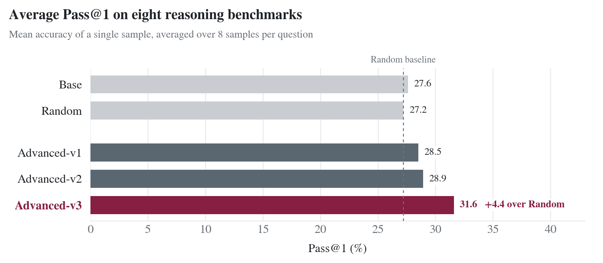
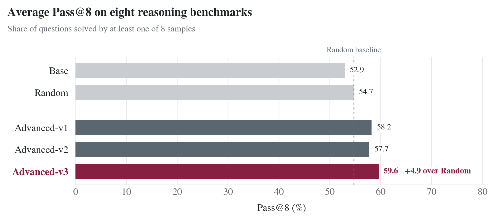
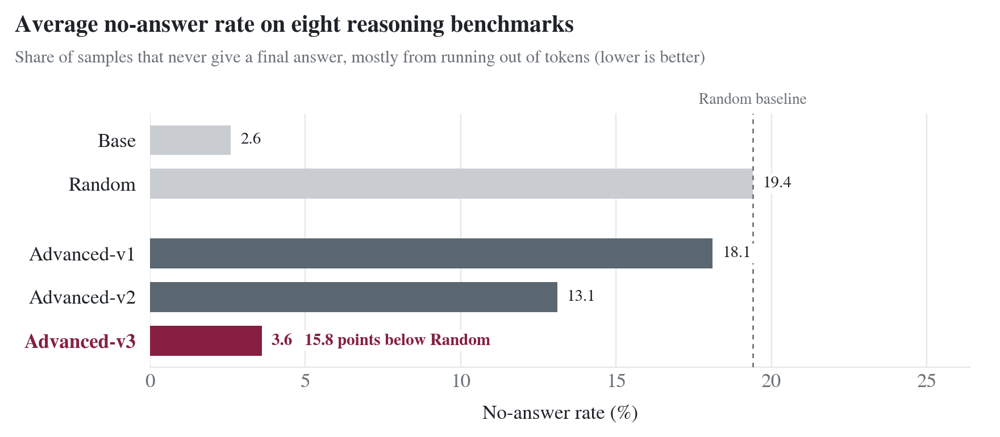

# ECE 6514 Project 1: Selecting 15K Reasoning Samples for SFT of Qwen2.5-3B-Instruct

Michael Arthur, Kiara Klevar, Joseph Leonard, Gia Subedi

TML Group 1, Virginia Tech, October 2026

**Summary.** Our submitted model, **Advanced-v3**, is Qwen2.5-3B-Instruct fine-tuned for 5 epochs on 15K short, clean math solutions that fit in the training context without truncation. It reaches 31.6 average pass@1, compared with 27.2 for the model trained on a random 15K subset and 27.6 for the base model (+4.4 and +4.0). Its pass@8 is 59.6, compared with 54.7 and 52.9 (+4.9 and +6.7). Only 3.6% of its samples end without an answer. Two things got us there: picking training data in the answer format the grader actually rewards (§4), and training long enough for the model to learn how to finish its reasoning (§7).

## 1. Task

We fine-tune `Qwen/Qwen2.5-3B-Instruct` with full-parameter SFT on 15,000 samples chosen from the 100K-sample AceReason-1.1-SFT subset (`redsgnaoh/acereason11_100k`), and then evaluate on 8 math and science benchmarks. Every model uses the same hyperparameters. Only the training data changes, plus the number of epochs for Advanced-v3.

| Model | Training data | Epochs |
|---|---|---|
| **Base** | none (the original Qwen2.5-3B-Instruct) | — |
| **Random** | 15K uniformly random rows (the baseline to beat) | 3 |
| **Advanced-v1** | 15K rows that pass our eval-aligned filters (§4.2) | 3 |
| **Advanced-v2** | 15K rows from the same filters, short solutions only (§4.3) | 3 |
| **Advanced-v3** (submitted) | the Advanced-v2 data (§4.4) | 5 |
| Qwen LORA | diversity15k dataset| 1|
|**Diversity 50** | 15k samples selected using 50 semantic clusters |2|
|**Diversity 100**| 15k samples selected using 100 semantic clusters| 2|

| | Link |
|---|---|
| Code | https://github.com/kiarak425/TML-Group1 |
| Datasets | [random-15k](https://huggingface.co/datasets/josephl04/ece6514-p1-random-15k), [advanced-15k](https://huggingface.co/datasets/josephl04/ece6514-p1-advanced-15k) (Advanced-v1), [concise-15k](https://huggingface.co/datasets/josephl04/ece6514-p1-concise-15k) (Advanced-v2 and Advanced-v3),[diversity15k](https://huggingface.co/datasets/marthur24/diversity15k) (Qwen LORA), [Diversity50 & Diversity100 - 15k](https://huggingface.co/datasets/gsubedi/AceReasons-diversity-15k) |
| Models | [advanced-v3](https://huggingface.co/josephl04/ece6514-p1-advanced-v3) (submitted), [random](https://huggingface.co/josephl04/ece6514-p1-random), [advanced-v1](https://huggingface.co/josephl04/ece6514-p1-advanced-v1), [Qwen LORA](https://huggingface.co/marthur24/qwen2.5-3b-finetuned) |

## 2. Evaluation setup

We use the course's `eval/` harness. It generates with vLLM and then grades with a SymPy-based checker that compares the **last** `\boxed{}` in each response against the gold answer. We sample with temperature 0.6, top-p 0.95, 8 samples per question, at most 32,768 new tokens, and seed 0. The system prompt is "Please reason step by step, and put your final answer within \boxed{}." and the user turn is the question.

The 8 benchmarks are AIME 2024 (30 questions), AMC (40), MATH-500 (500), Minerva (272), OlympiadBench (675), CN-Math-2024 (30), Kaoyan (199, in Chinese, mostly multiple-choice letters) and GPQA-Diamond (198, multiple-choice letters).

We report three numbers. **Pass@1** is the mean per-sample accuracy and is our main metric, since the eval README asks for it. **Pass@8** is the fraction of questions where at least one of the 8 samples is correct; this was the Fall 2025 leaderboard metric. The **no-answer rate** is the share of samples with no `\boxed{}` at all, which means the model either ran out of tokens or never wrapped up.

We ran everything on ARC's 24 GB A30 and 48 GB L40S GPUs, where vLLM 0.6.1 kept crashing on long generations. To get around this we made three memory-related changes to the harness, none of which touch the prompts, sampling parameters or grading. First, the 8 samples are drawn as 8 single-sample rounds instead of one `n=8` request, which gives the same distribution (7 of the 8 Base benchmarks had already run with `n=8` before we hit the crash). Second, vLLM's GPU memory use is capped at 88% on GPUs under 50 GB. Third, the large benchmarks are evaluated in 60-question chunks that are merged afterwards.

As a sanity check, our Base pass@8 matches the course's Fall 2025 leaderboard baseline to within sampling noise, for example AMC 70.0 vs 70.0, MATH 84.8 vs 84.4, GPQA 73.7 vs 74.2 and OlympiadBench 52.1 vs 49.5.

## 3. Data analysis

Before picking a strategy we profiled the pool. All token counts use the Qwen2.5 tokenizer on system + prompt + response.

The random 15K is 67.5% math (OpenMathReasoning, NuminaMath-CoT) and 32.5% code (OpenCodeReasoning, opc-sft-stage2, LeetCode, TACO and others). The code samples never end in `\boxed{}`: in a 500-row sample, 0 of 157 code responses had a `\boxed{}` after `</think>`, compared with 343 of 343 math responses. Since the grader only reads `\boxed{}` and every benchmark is math or science, roughly a third of a random subset teaches an answer format that scores zero.

Long responses are a second problem. With `cutoff_len` set to 16,384, 537 of the random 15K samples (3.6%) get cut off during training and lose their final answer and end-of-turn token, so the model learns from the reasoning but never sees how it ends.

Finally, about 7% of the math prompts ask for a proof ("Prove that…", "Show that…"), all of them from NuminaMath-CoT. Their "answers" are sentences like `\text{The pentagon is regular.}`, which no benchmark grades.

## 4. Data selection strategy

### 4.1 Random baseline
15,000 rows drawn uniformly from all 100K (seed 42).

### 4.2 Advanced-v1: eval-aligned filtering plus a difficulty floor

A row is kept only if it passes **all** of the following filters (`scripts/select_data.py --strategy advanced`):

1. It is math. This removes all the code samples.
2. It has exactly one non-empty `\boxed{}` after `</think>`, so the final answer is unambiguous and in the format the grader extracts.
3. It is not a proof. We drop prompts that match `prove|show that|demonstrate`, and boxed answers that contain a `\text{…}` phrase of three or more words. Short unit text such as `5 \text{ cm}` is kept.
4. It fits in the training context without truncation: its tokens plus a 64-token margin for the chat template must be at most 16,384. That way every kept sample trains on its full reasoning, its answer and its end-of-turn token.
5. Its problem is unique, using exact deduplication on lower-cased, whitespace-normalized prompt text.

After filtering we apply a difficulty floor and drop the shortest 20% of the remaining pool by token length. Response length is a cheap stand-in for difficulty, and very short solutions are mostly routine problems. We then sample 15,000 uniformly from what is left.

### 4.3 Advanced-v2: the same filters, short solutions only

When we evaluated Advanced-v1, about 18% of its samples never reached a `\boxed{}` answer, and on AIME it was 35% (§6). The model kept going until it hit the 32,768-token limit. It had picked up the habit of long chains of thought without learning when to stop.

Advanced-v2 keeps filters 1–5 from Advanced-v1 but swaps the difficulty floor for a **length band** that only keeps samples between 1,000 and 6,000 tokens (the median clean math sample is about 6,400 tokens). The model then only sees solutions that finish well within its budget. As a bonus, training is about twice as fast.

| Stage | Advanced-v1 | Advanced-v2 |
|---|---:|---:|
| Full pool | 100,000 | 100,000 |
| Math, one final `\boxed{}`, no proof, unique (filters 1–3, 5) | 50,419 | 50,419 |
| Also fits `cutoff_len` without truncation (filter 4) | 48,572 | 48,572 |
| After the difficulty floor / length band | 38,858 | 21,984 |
| Uniform sample | **15,000** | **15,000** |

### 4.4 Advanced-v3: the Advanced-v2 data, 5 epochs

The biggest single improvement we measured came from going from epoch 2 to epoch 3 (§7). So for Advanced-v3 we kept exactly the Advanced-v2 data and settings and trained for 5 epochs instead of 3.

### 4.5 Qwen LORA, 1 epoch

This model was trained using a dataset derived from running the acereason dataset through the DataSelection_Diversity_full_run.ipynb file. It was trained in Colab using an A100 due to time constraints before the project deadline was extended. The DataSelection-Diversity-full_run.ipynb file creates 100 clusters of embeddings questions from the dataset to ensure that the resulting selection is sufficiently diverse. The model was only trained for 1 epoch due to budget constraints, and used LORA due to resource constraints. Unsurprisingly, this model performed the worst in evaluation. It was trained for 1 epoch, and it did not use full fine-tuning. The hyperparameters for this model can be found in scripts/Lora_Train_1_epoch.ipynb.

### 4.6 Diversity based sampling

To test how the model would perform with a diverse dataset, we also investigated semantic diversity as a data selection strategy. In this approach, we didn’t filter based on length or answer format. We solely focused on selecting a subset of data that represented various question types that were present in the data. Our hypothesis was that diversity based sampling would improve the model’s generalization.

For this, following the suggested steps in Step 7 of the project instructions, we first generated embeddings for all 100k questions in the AceReasons dataset. We used all-MiniLM-L6-v2 to generate the embeddings. We then used KMeans clustering to create groups of questions based on their semantic similarity. To experiment if a different number of clusters would influence model performance, we created two different datasets using 50 and 100 clusters respectively.

Diversity 50 : 50 clusters, with 300 questions sampled from each cluster
Diversity 100: 100 clusters, with 150 questions sampled from each cluster

Both of these datasets contain 15,000 examples and use balanced sampling to encourage equal representation of various question types.

These datasets are published on HuggingFace.

### 4.7 Resulting datasets

| | Random | Advanced-v1 | Advanced-v2 / Advanced-v3 |
|---|---:|---:|---:|
| Math / code | 10,128 / 4,872 | 15,000 / 0 | 15,000 / 0 |
| OpenMathReasoning / NuminaMath-CoT | 8,092 / 2,036 | 13,207 / 1,793 | 12,389 / 2,611 |
| Mean / median tokens | 7,501 / 6,602 | 8,325 / 7,639 | 3,578 / 3,534 |
| p90 / max tokens | 14,424 / 31,024 | 13,968 / 16,310 | 5,496 / 6,000 |
| Truncated at `cutoff_len` | 537 (3.6%) | 0 | 0 |
| Ends in a final `\boxed{}` answer | ≈ 2/3 of rows | all rows | all rows |

## 5. Training

All models use one config (`configs/train.yaml`). It follows the assignment's suggested settings, with three changes to save memory: no CPU offload, PyTorch SDPA attention instead of flash-attn, and Liger kernels.

| Hyperparameter | Value |
|---|---|
| Base model | Qwen/Qwen2.5-3B-Instruct |
| Method | Full fine-tuning, DeepSpeed ZeRO-3, bf16 |
| Framework | LLaMA-Factory (the commit pinned by the course), `qwen` chat template |
| Kernels | Liger 0.6.2 (fused linear cross-entropy, RMSNorm, SwiGLU, RoPE). Same loss, but the logits are never fully materialized, so 16K-token samples fit on 48 GB GPUs |
| Loss | Response tokens only, with the same system prompt as the eval |
| Max sequence length (`cutoff_len`) | 16,384 |
| Learning rate / schedule | 5e-6, cosine, no warmup |
| Epochs | 3 (Advanced-v3: 5) |
| Batch | 1 per GPU, global batch 8 (2 GPUs × gradient accumulation 4) |
| Seed | 42 |
| Hardware | 2× NVIDIA L40S 48 GB (ARC Falcon) |
| Wall-clock | Random ≈ 27 h, Advanced-v1 ≈ 29 h, Advanced-v2 ≈ 13 h, Advanced-v3 ≈ 20.5 h |

Random and Advanced-v1 took about 27–29 hours for three epochs, which doesn't fit in ARC's 24-hour job limit. We stopped those runs right after the epoch-2 checkpoint (step 3,750 of 5,625) and trained epoch 3 as a second job starting from that checkpoint, for 1 epoch with learning rate 1.25e-6 (where the 3-epoch cosine schedule is at that point) decaying to 0, with seed 44. This resets the AdamW optimizer state, which is a small difference from a single uninterrupted run. Advanced-v2 and Advanced-v3 are short enough to train in one job.

## 6. Results

Advanced-v3 (bold row) is our submitted model. In each column the best value is in bold if no other model ties it. Qwen2.5-3b-diversity15k-lora was omitted from charts for poor performance.

Pass@1 (%), mean over 8 samples:

| Model | AIME24 | AMC | CN-Math-24 | GPQA | Kaoyan | MATH-500 | Minerva | OlympiadBench | AVG |
|---|---|---|---|---|---|---|---|---|---|
| Base | 7.9 | 38.8 | 7.9 | **28.7** | 21.9 | 65.5 | **22.3** | 28.1 | 27.6 |
| Random | 6.7 | 38.4 | 12.9 | 19.3 | 30.3 | 63.9 | 18.2 | 28.0 | 27.2 |
| Qwen LORA | 0.0 | 9.4 | 0.8 | 14.8 | 3.9 | 34.4 |8.6 | 9.6 | 10.2 |
| Advanced-v1 | 7.1 | 41.6 | 12.9 | 20.1 | 28.2 | 66.5 | 19.9 | 31.6 | 28.5 |
| Advanced-v2 | 7.5 | 43.1 | 11.7 | 21.5 | 30.1 | 66.7 | 20.8 | 29.9 | 28.9 |
| **Advanced-v3** | **10.0** | **46.2** | 12.9 | 26.4 | **34.0** | **68.5** | 21.9 | **32.9** | **31.6** |

Pass@8 (%), at least one of 8 correct:

| Model | AIME24 | AMC | CN-Math-24 | GPQA | Kaoyan | MATH-500 | Minerva | OlympiadBench | AVG |
|---|---|---|---|---|---|---|---|---|---|
| Base | 23.3 | 70.0 | 26.7 | 73.7 | 53.3 | 84.8 | **39.0** | 52.1 | 52.9 |
| Random | 23.3 | 67.5 | 36.7 | 68.7 | 68.8 | 86.0 | 34.9 | 51.4 | 54.7 |
| Qwen LORA | 0.0 | 32.5 | 3.3 | 58.6 | 20.1 | 63.4 | 23.5 | 27.1 | 28.6 |
| Advanced-v1 | 23.3 | 75.0 | 43.3 | 73.2 | 67.3 | **90.0** | 36.8 | 56.9 | 58.2 |
| Advanced-v2 | 23.3 | 72.5 | **46.7** | 73.2 | 65.8 | 88.8 | 35.3 | 55.7 | 57.7 |
| **Advanced-v3** | 23.3 | **80.0** | 40.0 | **76.8** | **70.9** | 89.0 | 37.5 | **59.4** | **59.6** |

No-answer rate (%), samples with no `\boxed{}` at all. Lower is better; Base is included for reference:

| Model | AIME24 | AMC | CN-Math-24 | GPQA | Kaoyan | MATH-500 | Minerva | OlympiadBench | AVG |
|---|---|---|---|---|---|---|---|---|---|
| Base | **6.7** | **1.2** | 4.2 | **0.6** | 5.8 | **0.4** | **0.2** | **1.6** | **2.6** |
| Random | 37.9 | 18.8 | 21.2 | 26.3 | 7.9 | 9.1 | 14.9 | 19.0 | 19.4 |
| Qwen LORA | 58.8 | 49.4 | 40.8 | 31.7 | 71.0 | 30.2 | 46.5 | 49.1 | 47.2 |
| Advanced-v1 | 35.4 | 15.3 | 20.8 | 26.0 | 8.2 | 7.5 | 13.3 | 18.6 | 18.1 |
| Advanced-v2 | 30.0 | 9.7 | 11.2 | 18.0 | 6.5 | 5.5 | 10.6 | 13.5 | 13.1 |
| **Advanced-v3** | 9.2 | 2.5 | **3.3** | 3.5 | **0.9** | 2.0 | 3.0 | 4.8 | 3.6 |

*(Tables generated with `scripts/summarize.py`.)*

## 7. Analysis

**Data selection beats random on both metrics.** On pass@1, Advanced-v1 is 1.3 points above Random (28.5 vs 27.2) and Advanced-v2 is 1.7 points above (28.9). On pass@8 the gaps are +3.5 (58.2 vs 54.7) and +3.0 (57.7). Random SFT, on the other hand, barely changes the base model: −0.4 on pass@1 and +1.8 on pass@8. So nearly all of the gain from fine-tuning comes from *which* 15K samples we train on.

**Where the gains come from.** Our selected-data models improve most on competition math (AMC, CN-Math, MATH-500 and OlympiadBench) and also on Kaoyan. On the other hand, every fine-tuned model scores below Base on GPQA (science) and Minerva. Our training data is all math (and Random's is math plus code), so nothing in it teaches graduate-level science. The models also ramble on GPQA: 18–26% of the GPQA samples from Random, Advanced-v1 and Advanced-v2 end with no answer, compared with 0.6% for Base.

**Unfinished answers are what holds pass@1 back.** Fine-tuning on long chains of thought makes the models think a lot longer. For Random, Advanced-v1 and Advanced-v2, 13–19% of samples hit the 32K limit without a final answer (30–38% on AIME), compared with 2.6% for Base. The ordering lines up with our data analysis. Random is the worst at 19.4%, since a third of its data is code that never ends in `\boxed{}` and 3.6% of its samples were truncated. Advanced-v1 comes next at 18.1%: every sample ends in one clean answer, but the solutions are long (8.3K tokens on average). Advanced-v2 does best at 13.1% with its shorter solutions (3.6K tokens on average), and it also has the best pass@1 of the three.

**SFT improves coverage more than consistency.** Compared with Base, Advanced-v1 gains 5.3 points of pass@8 but only 0.9 of pass@1. The models now solve problems that Base never solved in 8 tries, but the unfinished samples drag down their per-sample accuracy. Advanced-v2 gives up a little coverage (−0.5 pass@8 vs Advanced-v1) for a bit more consistency (+0.4 pass@1).

**More training helps.** We evaluated the epoch-2 checkpoints of Random and Advanced-v1 on the benchmarks that fit our GPU budget:

| | Pass@1 (avg) | No-answer (avg) |
|---|---|---|
| Random, epoch 2 → 3 (6 benchmarks) | 17.9 → 21.0 | 28.2% → 21.2% |
| Advanced-v1, epoch 2 → 3 (5 benchmarks) | 18.8 → 20.3 | 29.7% → 22.2% |

Part of this jump comes from the cosine schedule decaying to zero during epoch 3. Still, it is what led us to Advanced-v3, which uses the Advanced-v2 data for 5 epochs instead of 3. Advanced-v3 is our best model on both metrics: average pass@1 is 31.6 (Advanced-v2: 28.9), pass@8 is 59.6 (57.7), and unfinished answers drop to 3.6% (13.1%). It even recovers on GPQA, reaching 26.4 pass@1 compared with 21.5 for Advanced-v2, although its training data is pure math. Among the fine-tuned models it is the best or tied for best on all 8 benchmarks for pass@1.

Advanced-v3 learned to finish its answers *without* cutting its reasoning short. Its AIME pass@1 is 10.0, the best of all models, with only 9% unfinished (Advanced-v2: 30%). Our reading is that small models need more passes over long-reasoning data before they reliably conclude, and the assignment's default of 3 epochs was not enough.

**Preliminary Diversity Dataset Results**

Due to ARC GPU resources being limited, our models trained on Diversity 50 and Diversity 100 datasets only trained for 2 epochs as they exceeded the 24 hour limit before they reached epoch 3. We have requested longer runs for both but they have been queued for October 31st which is after our deadline. 

While these 2 epoch runs don’t directly correspond to the 3 epoch Random 15k run, we would still like to present the evaluation results using the same evaluation benchmarks described in section 2. 

Model | Epochs | Average Pass@1(%) | Average Pass@8(%) | No-answer rate
Diversity 50 | 2 | 25.0 | 51.7 | 26.4
Diversity 100 | 2 | 24.3 | 50.2 | 30.8

Diversity 50 achieved slightly higher average Pass@1 and Pass@8 scores than Diversity 100, and a lower no answer rate. However, these scores are close enough that we cannot determine a clear advantage between the two.

Both models had pretty high no answer rates, and when inspected, the incomplete answers were repetitive or excessively long without reaching a final boxed output. However, this is similar to what we observed with our other models at the 2 epoch stage, and might indicate lack of sufficient training rather than anything specific about the data selection strategy. We saw a drop in no answer rates significantly for our other models when training for 3 or 5 epochs, and we hypothesize that longer training may improve the no answer rates for the diversity datasets as well.

Once our longer training runs are completed, we plan to evaluate them using the same benchmarks and compare their performance against the random baseline as well as the other advanced data selection strategy we tested. 

## 8. Limitations and Improvements

Each configuration was trained only once (seed 42), because queue times on the shared cluster made repeats impractical. Differences under about 1 point are therefore within run-to-run noise, and AIME and CN-Math have only 30 questions each, so a single question is worth 3.3 points.

We use response length as a stand-in for difficulty. Measuring the base model's pass rate on each problem would be a better signal, but it would take several GPU-days of generation. The `\boxed{}` and proof filters are regex heuristics that we checked on a 500-row sample, not on the full pool. Finally, epoch 3 of Random and Advanced-v1 restarted the optimizer state (§5).

While working on the projects, there were many limitations we all faced. The main limitation was working with the GPU to run the batch jobs. The time to get the tests going and how long they took to execute were two challenges that we faced. When running the batch jobs, the time until a GPU would be free would vary from a couple of hours to a couple of days. This caused issues with trying to get evaluations of the models. Furthermore, even if the batch job ran, there was no guarantee that the job would not fail or that there would be issues with the job, and the evaluation would print out a table that would be partially blank because of the need for more time on the job. There were also scenarios where the batch job would fail after it was able to get an available GPU. The one thing that aided in this issue was having multiple people on a team to run these batch jobs. Running this whole project with only one person would have been difficult because of the long wait times between jobs. This allowed the team to gauge who had the closest time for the batch job to execute and what needed to be focused on next. Overall, we were able to work on different parts while also waiting for the batch jobs to run. 

When looking at the overall development of the project, there were a couple of areas that could have been improved upon. When doing setup, there were some issues that we faced as a team that caused issues in having a proper setup. Having a clearer setup would help because there were errors and issues with setting up programs that did leave the team stuck in certain areas. Another improvement focusing more on fine tuning. As we were limited on time and the batch jobs took up most of the time, there was a little less focus on fine tuning. If there was a way to have a dedicated GPU for the class, there might have been a lower wait time on when batch jobs would run.

## 9. Reproducing

The README walks through every step. In short, `scripts/select_data.py` builds the datasets, `slurm/train.sh` trains, `slurm/eval_all.sh` runs the evaluation, and `scripts/summarize.py` produces the tables. The data selection is deterministic (seed 42), and the unit tests run with `python -m pytest tests`.
